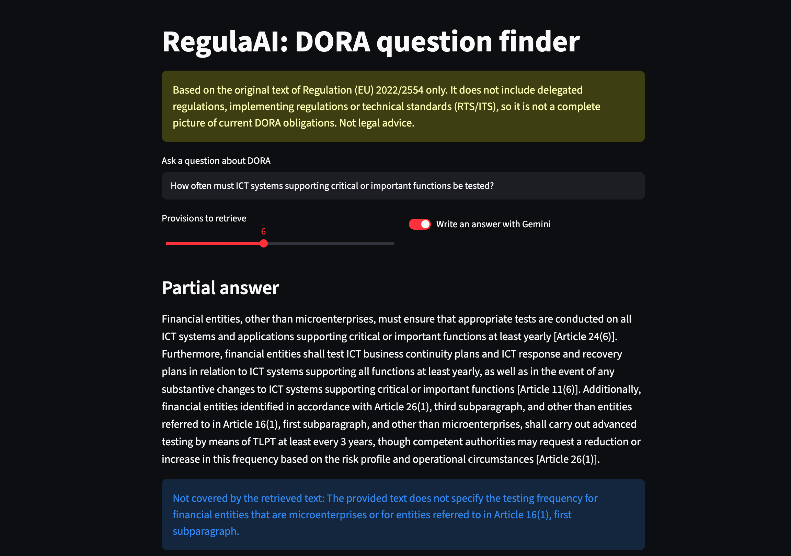
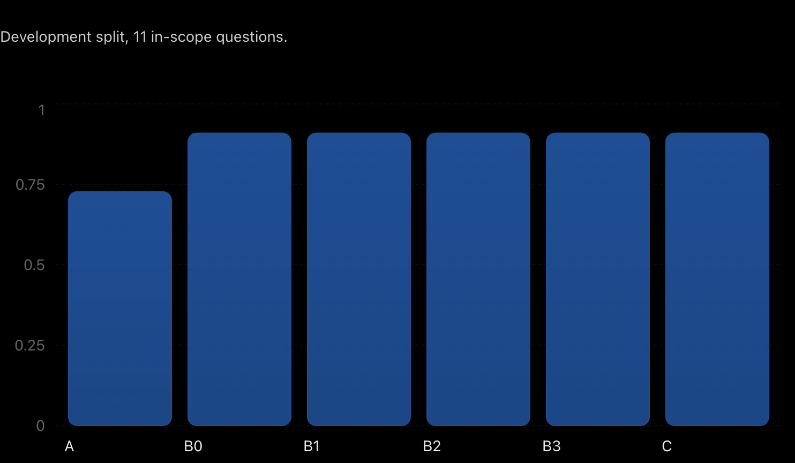

# RegulaAI – Legal RAG System for DORA



An experimental Retrieval-Augmented Generation (RAG) system for retrieving and answering questions about the **Digital Operational Resilience Act (DORA), Regulation (EU) 2022/2554**.

RegulaAI combines semantic search, keyword retrieval, legal-reference matching and ranking strategies to retrieve relevant regulatory provisions. Retrieved passages are then provided to Google Gemini to generate evidence-grounded answers with legal citations.

The project also investigates how different retrieval and ranking strategies affect retrieval quality through incremental experiments and quantitative evaluation.

## Project objectives

The main objectives of RegulaAI are:

- Retrieve relevant DORA articles and paragraphs from natural-language questions.
- Improve retrieval of legal definitions and article-title references.
- Combine semantic and keyword-based retrieval.
- Experiment with different ranking strategies.
- Generate answers grounded in retrieved legal provisions.
- Provide citations that allow users to trace answers back to the original regulation.
- Evaluate retrieval performance using a manually curated question dataset.

## Architecture

The application follows a modular RAG architecture.

```text
                 User Question
                       |
                       v
                Query Processing
                       |
                       v
              Hybrid Retrieval Layer
                /            \
               /              \
       Semantic Search     Keyword Search
         (BGE)               (BM25)
               \              /
                \            /
                 v          v
                 Ranking and Fusion
                       |
                       v
             Legal-Specific Retrieval
              /        |          \
          Direct   Definition   Title
          Lookup    Routing    Matching
                       |
                       v
              Optional Reranking
               (Cross-Encoder)
                       |
                       v
              Context Preparation
                       |
                       v
                Gemini LLM
                       |
                       v
             Structured Answer
                       |
                       v
             Citation Verification
                       |
                       v
             Grounded Response
```

## Retrieval and ranking methodology

The retrieval system was developed incrementally to investigate the contribution of different retrieval mechanisms.

The experiments consist of six configurations (A, B0, B1, B2, B3 and C). Each configuration builds upon the previous one by introducing one additional retrieval component or changing a ranking parameter.

### A – Baseline hybrid retrieval

The baseline combines two retrieval methods:

**1. Semantic retrieval**

- Embedding model: `BAAI/bge-small-en-v1.5`
- Encodes the user's question and regulatory passages into vector representations.
- Uses cosine similarity to identify semantically relevant passages.

**2. Keyword retrieval**

- Uses SQLite FTS5.
- Applies BM25 ranking.
- Searches article titles and provision text.

The two ranked result lists are combined using Reciprocal Rank Fusion (RRF).

### B0 – Direct article-reference retrieval

Adds a dedicated retrieval mechanism for explicit legal references.

Examples:

- Article 12(2)
- Article 26(3)
- Article 7

When an explicit reference is detected, the corresponding provision is retrieved directly from the database and receives a ranking boost.

This addresses a weakness of semantic retrieval: a question explicitly referring to a legal provision should not depend entirely on embedding similarity.

### B1 – Definition routing

Adds specialized retrieval for legal definitions.

The system identifies definition-style questions, such as:

- What is a vulnerability?
- What is an ICT asset?
- How does DORA define a legacy ICT system?

It then searches the definitions contained in Article 3.

Exact definition matches are preferred, with partial matching used as a fallback.

### B2 – Article-title matching

Introduces a title-matching mechanism.

The system compares meaningful query terms against article titles and provides a small ranking bonus when the article title matches the question.

This is intended to improve questions referring to regulatory topics using the wording of article headings.

### B3 – Semantic ranking weight adjustment

Increases the semantic retrieval weight from 1.0 to 1.5.

The purpose is to investigate whether giving semantic retrieval more influence improves the ranking of relevant legal provisions.

### C – Cross-encoder reranking

Introduces an optional cross-encoder reranker:

`BAAI/bge-reranker-base`

The reranker evaluates query-passage pairs and reorders retrieved candidates according to their relevance.

Explicit direct-lookup and definition matches remain pinned ahead of the reranked candidates.

The reranker is applied to the remaining candidate set rather than replacing the initial retrieval pipeline.

## Ranking fusion

The initial hybrid ranking combines semantic and keyword retrieval using a weighted reciprocal-rank formula:

\[
S(d)=
\frac{w_s}{k_0+r_s(d)}
+
\frac{w_k}{k_0+r_k(d)}
\]

Where:

- \(S(d)\): combined score of document \(d\).
- \(w_s\): semantic retrieval weight.
- \(w_k\): keyword retrieval weight.
- \(k_0\): RRF constant.
- \(r_s(d)\): semantic rank.
- \(r_k(d)\): keyword rank.

Additional signals are incorporated:

- Explicit article and definition matches receive an explicit boost.
- Article-title matches receive a title bonus.
- Explicit article and definition matches are pinned above the remaining candidates.

The cross-encoder can optionally reorder the non-pinned candidates.

## Experimental evaluation

An incremental retrieval experiment was conducted to measure the impact of the different retrieval strategies.

The evaluation uses a manually curated gold-standard dataset containing questions with expected articles, expected legal citations and expected answer behavior.

The configurations were evaluated on the development split.

### Development results

Number of in-scope questions: **11**

| Metric | A | B0 | B1 | B2 | B3 | C |
|---|---:|---:|---:|---:|---:|---:|
| Article Recall@3 | 0.727 | 0.909 | 0.909 | 0.909 | 0.909 | 0.909 |
| Article Recall@6 | 0.727 | 0.909 | 0.909 | 0.909 | 0.909 | 0.909 |
| Complete@6 | 0.727 | 0.909 | 0.909 | 0.909 | 0.909 | 0.909 |
| MRR | 0.737 | 0.919 | 0.919 | 0.919 | 0.922 | 0.909 |
| Paragraph Recall@6 | 0.667 | 0.889 | 0.889 | 0.889 | 0.889 | 0.889 |
| Context Paragraph Recall | 0.667 | 0.889 | 0.889 | 0.889 | 1.000 | 0.889 |



### Metric definitions

- **Article Recall@3:** Proportion of questions for which at least one expected article appears in the top three retrieved articles.
- **Article Recall@6:** Proportion of questions for which at least one expected article appears in the top six.
- **Complete@6:** Proportion of questions for which all expected articles appear in the top six.
- **MRR:** Mean Reciprocal Rank of the first relevant article.
- **Paragraph Recall@6:** Average proportion of expected legal citations retrieved in the top six raw results.
- **Context Paragraph Recall:** Average proportion of expected legal citations available after context expansion.
- **False Gate:** Proportion of in-scope questions incorrectly rejected by the scope/confidence gate.
- **OOS Rejected:** Number of out-of-scope questions correctly rejected.

### Experimental observations

**1. Direct article lookup provided the largest improvement.**

Adding direct article-reference retrieval (A → B0) improved:

- Article Recall@3 from 0.727 to 0.909.
- MRR from 0.737 to 0.919.
- Paragraph Recall@6 from 0.667 to 0.889.

The change log shows that explicit article-reference questions P01 and P03 improved from no relevant article in the evaluated ranking to rank 1.

**2. Definition routing showed no additional improvement on this development split.**

B0 → B1 produced no measurable changes.

**3. Article-title matching showed no additional improvement on this development split.**

B1 → B2 produced no measurable changes.

**4. Increasing semantic weight produced a small improvement.**

B2 → B3 increased MRR from 0.919 to 0.922 and Context Paragraph Recall from 0.889 to 1.000.

Question P20 improved in article ranking from position 9 to position 7. Its expected paragraph was still absent from the top six raw retrieval results, but was recovered through context expansion.

**5. Cross-encoder reranking did not improve the measured results.**

B3 → C reduced MRR from 0.922 to 0.909.

Article Recall@3 and Paragraph Recall@6 remained unchanged, while Context Paragraph Recall returned to 0.889.

Question P20 was no longer retrieved in the evaluated ranking after reranking.

This demonstrates that introducing a more sophisticated ranking model does not necessarily improve retrieval performance. The results suggest that reranking should be evaluated against the actual legal retrieval task rather than assumed to be beneficial.

### Experimental conclusion

On the reported development split, B3 achieved the strongest overall retrieval results.

The most substantial improvement came from direct article-reference retrieval. Definition routing and article-title matching did not change the measured metrics on this dataset, while the cross-encoder reranker reduced MRR.

These results are preliminary and should not be interpreted as proof of generalization. Further testing on a larger, independent test dataset is necessary.

## Answer generation and grounding

Retrieved regulatory provisions are passed to Google Gemini for answer generation.

The answer-generation layer uses:

- Structured Pydantic output.
- Evidence-grounded prompting.
- Explicit answer coverage states.
- Source labels.
- Citation validation.
- Partial-answer and insufficient-evidence handling.

The system distinguishes between fully supported, partially supported and unsupported answers.

## Technology stack

| Component | Technology |
|---|---|
| Programming language | Python |
| User interface | Streamlit |
| LLM | Google Gemini |
| Embedding model | BAAI/bge-small-en-v1.5 |
| Reranker | BAAI/bge-reranker-base |
| Vector similarity | NumPy |
| Keyword search | SQLite FTS5 / BM25 |
| Database | SQLite |
| Structured output | Pydantic |
| Evaluation | Custom Python evaluation pipeline |

## Project limitations

The current implementation focuses on the original text of Regulation (EU) 2022/2554.

It does not yet provide comprehensive coverage of:

- DORA delegated regulations.
- Regulatory Technical Standards (RTS).
- Implementing Technical Standards (ITS).
- All relevant supervisory guidance and supplementary regulatory materials.

Other limitations include:

- The evaluation dataset is still small.
- Development-set results do not establish generalization.
- Citation validation does not independently establish semantic entailment for every legal claim.
- The application is a research prototype, not a certified legal compliance assessment tool.

## Future work

Planned improvements include:

- Expanding the regulatory knowledge base to include applicable DORA RTS and ITS.
- Improving citation and claim-level evidence verification.
- Expanding the evaluation dataset.
- Evaluating answer faithfulness and completeness.
- Investigating alternative retrieval and reranking strategies.
- Adding regulatory version tracking and update detection.
- Developing document-based compliance assessment.
- Mapping regulatory obligations to organizational controls and evidence.

## Disclaimer

RegulaAI is an experimental legal information retrieval and question-answering system. It is intended for research and informational purposes and does not constitute legal advice or replace professional legal assessment.